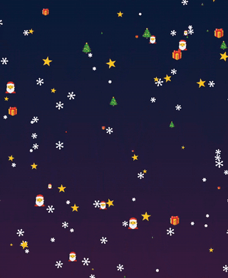
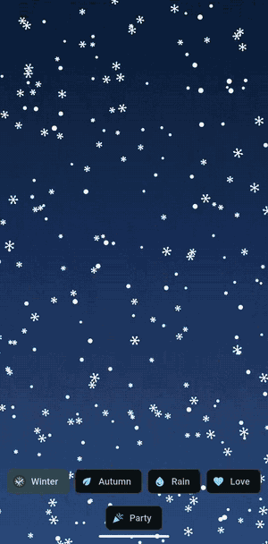
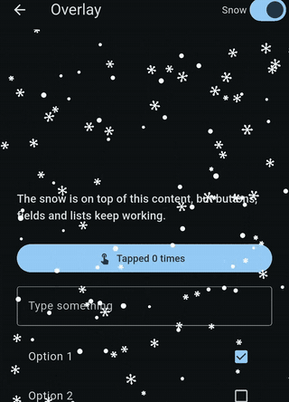
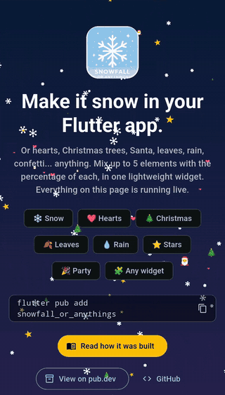

<div align="center">
  

# Snowfall or Anythings

**Make it snow in your Flutter app. Or rain hearts, Christmas trees, Santa, leaves, stars, confetti… anything.**

Falling particle effects in one lightweight widget: snowfall, rain, autumn leaves,
Valentine's hearts, Christmas decorations, party confetti, or any widget, emoji or image you want.
Mix up to 5 elements and choose the percentage of each one.

[](https://pub.dev/packages/snowfall_or_anythings)
[](https://pub.dev/packages/snowfall_or_anythings/score)
[](https://pub.dev/packages/snowfall_or_anythings/score)
[](LICENSE)
[](https://snowfall.valdir.dev.br)

### [▶️ Try the live demo](https://snowfall.valdir.dev.br) · [📝 Read how it was built](https://blog.valdir.dev.br/snowfall-or-anythings-como-foi-construido) · [📦 pub.dev](https://pub.dev/packages/snowfall_or_anythings)

</div>

| Christmas mix (snow + stars + 🎅 🎄 🎁) | Seasonal presets | Overlay: taps still work | Live demo app |
|:---:|:---:|:---:|:---:|
|  |  |  |  |

> 📝 **How was it built?** Time-based animation, painting hundreds of particles without
> rebuilding widgets, mixing shapes and emojis with percentages, and evolving a published
> package without breaking changes.
> **[Read the full article on the blog →](https://blog.valdir.dev.br/snowfall-or-anythings-como-foi-construido)**

## Features

- ❄️ **Snow or anything**: 6 built-in shapes (snowflake, circle, star, heart, leaf, raindrop) or **any widget** (images, icons, emojis)
- 🎄 **Mix up to 5 elements** at once, with the **percentage** of each one (e.g. 60% snow, 20% stars, 10% Santa, 10% trees)
- ⚡ **Lightweight**: particles are painted directly on the canvas, with no widget rebuild per frame
- ⏱️ **Same speed on every screen** (60 Hz, 90 Hz, 120 Hz), with an optional FPS cap (`maxFps`) to save battery
- 👆 **Overlay friendly**: put it on top of your screen and buttons, fields and lists below keep working
- 🔄 **Change anything at runtime** (colors, sizes, amount, mix), no `Key` tricks needed
- 🎯 **Custom painters** for your own shapes
- 🧩 **Zero dependencies**, pure Flutter: Android, iOS, web, Windows, macOS and Linux

## Installation

```bash
flutter pub add snowfall_or_anythings
```

Or add it to your `pubspec.yaml`:

```yaml
dependencies:
  snowfall_or_anythings: ^0.0.9
```

## Quick start

```dart
import 'package:snowfall_or_anythings/snowfall_or_anythings.dart';

// Snow falling over your page
Stack(
  children: [
    const MyPageContent(),
    const Positioned.fill(
      child: SnowfallOrAnythings(particleType: ParticleType.snowflake),
    ),
  ],
)
```

That's it. The widget fills the space it's given, and touches pass through to your content.

## Mixing elements (up to 5) 🎄

Use `particleVariants` to make different things fall together. Each `ParticleVariant` uses a
built-in shape (`type`) **or** any widget (`widget`), and `weight` sets its share:

```dart
SnowfallOrAnythings(
  numberOfParticles: 150,
  particleVariants: const [
    ParticleVariant(type: ParticleType.snowflake, weight: 60),                 // 60%
    ParticleVariant(type: ParticleType.star, color: Colors.amber, weight: 20), // 20%
    ParticleVariant(widget: FittedBox(child: Text('🎅')), size: 28, weight: 10),
    ParticleVariant(widget: FittedBox(child: Text('🎄')), size: 28, weight: 10),
  ],
)
```

- Weights are proportional (`60, 20, 10, 10` is the same as `6, 2, 1, 1`) and the split is
  exact: with 150 particles you get 90 snowflakes, 30 stars, 15 Santas and 15 trees.
- `color`, `size` and `speed` are optional per variant and default to the widget's
  `particleColor`, `particleSize` and `particleSpeed`.
- The same shape can appear more than once with different colors (autumn leaves in orange, red and yellow).
- Up to `SnowfallOrAnythings.maxParticleVariants` (5) entries are used.
- With a `customPainter`, the variants still define how many particles of each kind exist;
  use `particle.variantIndex` to draw each one differently.

## Recipes

### ❄️ Snowfall

```dart
SnowfallOrAnythings(
  numberOfParticles: 200,
  particleSize: 4.0,
  particleSpeed: 0.8,
  particleType: ParticleType.snowflake,
)
```

### ❤️ Falling hearts (Valentine's Day)

```dart
SnowfallOrAnythings(
  numberOfParticles: 80,
  particleSize: 12.0,
  particleVariants: const [
    ParticleVariant(type: ParticleType.heart, color: Colors.redAccent),
    ParticleVariant(type: ParticleType.heart, color: Colors.pinkAccent),
  ],
)
```

### 🍂 Autumn leaves

```dart
SnowfallOrAnythings(
  numberOfParticles: 70,
  particleSize: 14.0,
  particleVariants: const [
    ParticleVariant(type: ParticleType.leaf, color: Colors.orange),
    ParticleVariant(type: ParticleType.leaf, color: Colors.redAccent),
    ParticleVariant(type: ParticleType.leaf, color: Colors.amber),
  ],
)
```

### 💧 Rain

```dart
SnowfallOrAnythings(
  numberOfParticles: 300,
  particleSize: 5.0,
  particleSpeed: 6.0,
  particleColor: Colors.lightBlueAccent,
  particleType: ParticleType.raindrop,
)
```

### ⭐ Stars

```dart
SnowfallOrAnythings(
  numberOfParticles: 100,
  particleSize: 10.0,
  particleSpeed: 0.8,
  particleColor: Colors.yellow,
  particleType: ParticleType.star,
)
```

### 🎉 Party confetti

```dart
SnowfallOrAnythings(
  numberOfParticles: 160,
  particleSpeed: 2.0,
  particleVariants: const [
    ParticleVariant(type: ParticleType.circular, color: Colors.yellowAccent, size: 4),
    ParticleVariant(type: ParticleType.circular, color: Colors.cyanAccent, size: 4),
    ParticleVariant(type: ParticleType.star, color: Colors.pinkAccent, size: 8),
    ParticleVariant(widget: FittedBox(child: Text('🎉')), size: 28),
  ],
)
```

### 🧩 Any widget as a particle

```dart
SnowfallOrAnythings(
  numberOfParticles: 50,
  particleSize: 20.0,
  particleSpeed: 1.5,
  particleWidget: const Icon(Icons.favorite, color: Colors.red),
)

// or an image
SnowfallOrAnythings(
  numberOfParticles: 100,
  particleSize: 30.0,
  particleWidget: Image.asset('assets/snowflake.png'),
)
```

Each widget is placed with its top-left corner at the particle position and sized
`particle.size × particle.size`. Widget particles keep receiving touches, so you can make
them tappable (see the "Widget particles" demo).

### 🎯 Custom painter

Draw your own shapes. The painter receives all particles (position, size, color, `variantIndex`):

```dart
SnowfallOrAnythings(
  particleColor: Colors.green,
  numberOfParticles: 150,
  particleSize: 10.0,
  particleSpeed: 2.0,
  customPainter: ({required particles}) => SquarePainter(particles),
)

class SquarePainter extends CustomPainter {
  SquarePainter(this.particles);

  final List<Particle> particles;

  @override
  void paint(Canvas canvas, Size size) {
    final paint = Paint();
    for (final particle in particles) {
      paint.color = particle.color;
      canvas.drawRect(
        Rect.fromCenter(
          center: Offset(particle.x, particle.y),
          width: particle.size,
          height: particle.size,
        ),
        paint,
      );
    }
  }

  @override
  bool shouldRepaint(covariant CustomPainter oldDelegate) => true;
}
```

> Particles are centered on `(particle.x, particle.y)` by the built-in painters.

### 🔋 Saving battery

By default the animation follows the display refresh rate. Use `maxFps` to cap it: the
falling speed stays the same, only the smoothness changes.

```dart
SnowfallOrAnythings(
  numberOfParticles: 300,
  particleType: ParticleType.snowflake,
  maxFps: 30,
)
```

## Particle types

| Type | Description | Best for |
|------|-------------|----------|
| ❄️ `snowflake` | 6-branched snowflake with details | Winter, Christmas |
| ⚪ `circular` | Simple filled circles | Snow dust, bubbles, confetti |
| ⭐ `star` | 5-pointed stars with random orientation | Night sky, magic, celebrations |
| ❤️ `heart` | Heart shapes | Valentine's Day, love themes |
| 🍂 `leaf` | Leaves with veins and random tilt | Autumn, nature |
| 💧 `raindrop` | Teardrop shapes | Rain, water |

## API reference

### SnowfallOrAnythings

| Parameter | Type | Default | Description |
|-----------|------|---------|-------------|
| `numberOfParticles` | `int` | `200` | Number of particles on screen |
| `particleColor` | `Color` | `Colors.white` | Color of built-in shapes |
| `particleSize` | `double` | `4.0` | Base size: each particle gets a random size from `2` to `particleSize + 2` (radius for built-in shapes, width/height for widgets) |
| `particleSpeed` | `double` | `1.0` | Falling speed: each particle gets a random speed from `1` to `particleSpeed + 1` px per frame at 60 FPS |
| `particleType` | `ParticleType` | `snowflake` | Built-in shape |
| `particleWidget` | `Widget?` | `null` | Widget used as particle |
| `particleVariants` | `List<ParticleVariant>?` | `null` | Up to 5 kinds of particles falling together, each with its share |
| `customPainter` | `Function?` | `null` | Your own painter: `({required particles}) => CustomPainter` |
| `maxFps` | `double?` | `null` | Maximum animation updates per second (`null` = display refresh rate) |
| `frameRateMs` | `int` | `16` | **Deprecated**, use `maxFps` |

### ParticleVariant

| Parameter | Type | Default | Description |
|-----------|------|---------|-------------|
| `type` | `ParticleType?` | `null` | Built-in shape (falls back to `particleType`) |
| `widget` | `Widget?` | `null` | Widget used as particle (use either `type` or `widget`) |
| `color` | `Color?` | `null` | Color for built-in shapes (falls back to `particleColor`) |
| `size` | `double?` | `null` | Base size (falls back to `particleSize`) |
| `speed` | `double?` | `null` | Speed (falls back to `particleSpeed`) |
| `weight` | `double` | `1` | Proportional share of particles, must be > 0 |

## Performance tips

1. **Fewer particles on small devices**: `numberOfParticles: MediaQuery.sizeOf(context).width > 600 ? 200 : 100`
2. **Cap the frame rate** for battery: `maxFps: 30`
3. **Prefer built-in shapes** for large amounts; `circular` is the cheapest
4. **Widget particles** are positioned without rebuilds, but each widget still costs more than a painted shape: keep them in the tens, not hundreds

## Migrating from 0.0.7

Nothing breaks. Two things are deprecated and will be removed in a future major version:

- `frameRateMs` never limited the frame rate: use `maxFps` instead (values other than `16` are converted automatically)
- `ParticlePainter`: use `CircularParticlePainter`

See the [CHANGELOG](CHANGELOG.md) for all fixes and improvements.

## Live demo & example app

Try every feature in your browser at **[snowfall.valdir.dev.br](https://snowfall.valdir.dev.br)**.
The same app lives in the [`example`](example) folder: playground with every parameter,
Christmas mix with percentages, seasonal presets, overlay, tappable widget particles,
custom painter and FPS control.

## Author

Created by **[Valdir Giorgi](https://blog.valdir.dev.br)**.

📝 Want to know how this package was designed and built?
**[Read the article on the blog](https://blog.valdir.dev.br/snowfall-or-anythings-como-foi-construido)**.

## Contributing

Contributions are welcome! Feel free to open a Pull Request.
Found a bug or have an idea? [Open an issue](https://github.com/ValdirGiorgi/snowfall_or_anythings/issues).

## License

MIT. See [LICENSE](LICENSE).
