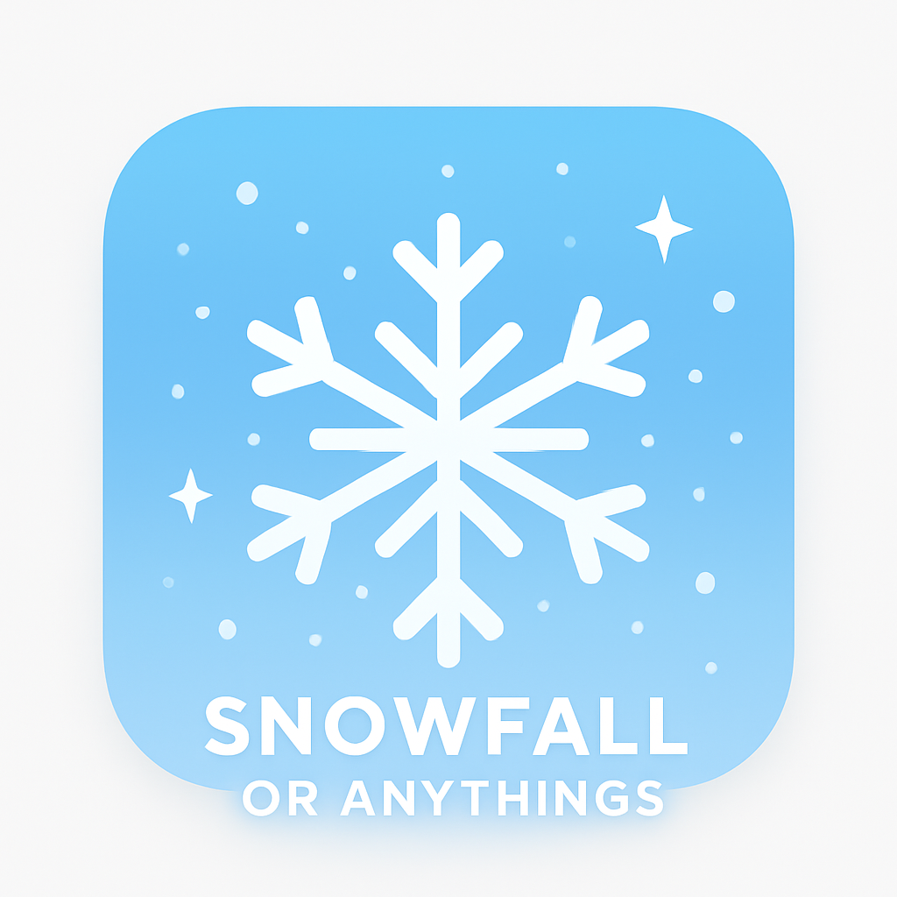

<div align="center">
  
</div>

# Snowfall or Anythings

A Flutter package to create beautiful snowfall or other particle effects in your applications with high performance and extensive customization options.

## Features

- 🎨 Multiple particle types (circular, snowflake, star, heart, leaf, raindrop)
- ⚡ High performance with optimized rendering
- 🎮 Full control over animation parameters
- 🔧 Highly customizable (colors, sizes, speeds, shapes)
- 📱 Responsive design with proper screen adaptation
- 🎯 Custom painter support for advanced effects
- 🧩 Widget-based particles for maximum flexibility
- ⏱️ Time-based animation (same speed on 60 Hz and 120 Hz displays) with optional FPS cap
- 👆 Doesn't block taps when used as an overlay (painter modes)
- 🔄 Parameters can be changed at runtime, no `Key` needed

## Particle Types

| Type | Description | Best For |
|------|-------------|----------|
| ⚪ `circular` | Simple filled circles | Rain, bubbles, generic effects |
| ❄️ `snowflake` | 6-branched snowflake with details | Winter/snow themes |
| ⭐ `star` | 5-pointed stars with random orientation | Night sky, magical effects |
| ❤️ `heart` | Heart shapes using Bézier curves | Valentine's, love themes |
| 🍂 `leaf` | Realistic leaves with veins and random tilt | Autumn, nature themes |
| 💧 `raindrop` | Teardrop shapes | Rain, water effects |

## Installation

Add the following to your `pubspec.yaml` file:

```yaml
dependencies:
    snowfall_or_anythings: ^0.0.8
```

Then run:
```bash
flutter pub get
```

## Usage

### Basic Snowfall Example

The simplest way to add a snowfall effect to your app:

```dart
import 'package:snowfall_or_anythings/snowfall_or_anythings.dart';

class SnowPage extends StatelessWidget {
  const SnowPage({super.key});

  @override
  Widget build(BuildContext context) {
    return Scaffold(
      appBar: AppBar(
        title: const Text('Snowfall Demo'),
      ),
      body: const SnowfallOrAnythings(
        numberOfParticles: 200,
        particleSize: 4.0,
        particleSpeed: 0.8,
        particleType: ParticleType.snowflake,
      ),
    );
  }
}
```

### Circular Particles

Use circular particles instead of snowflakes:

```dart
SnowfallOrAnythings(
  numberOfParticles: 150,
  particleSize: 6.0,
  particleSpeed: 1.2,
  particleColor: Colors.blue,
  particleType: ParticleType.circular,
)
```

### Star Particles

Create a starry night effect:

```dart
SnowfallOrAnythings(
  numberOfParticles: 100,
  particleSize: 10.0,
  particleSpeed: 0.8,
  particleColor: Colors.yellow,
  particleType: ParticleType.star,
)
```

### Heart Particles

Perfect for Valentine's Day or love-themed apps:

```dart
SnowfallOrAnythings(
  numberOfParticles: 80,
  particleSize: 12.0,
  particleSpeed: 1.0,
  particleColor: Colors.pink,
  particleType: ParticleType.heart,
)
```

### Leaf Particles

Create an autumn falling leaves effect:

```dart
SnowfallOrAnythings(
  numberOfParticles: 60,
  particleSize: 15.0,
  particleSpeed: 1.2,
  particleColor: Colors.orange,
  particleType: ParticleType.leaf,
)
```

### Raindrop Particles

Simulate rain with teardrop-shaped particles:

```dart
SnowfallOrAnythings(
  numberOfParticles: 200,
  particleSize: 8.0,
  particleSpeed: 3.0,
  particleColor: Colors.lightBlue,
  particleType: ParticleType.raindrop,
)
```

### Performance Tuning

By default the animation follows the display refresh rate. Use `maxFps` to cap
it and save battery. The falling speed stays the same, only the smoothness changes:

```dart
SnowfallOrAnythings(
  numberOfParticles: 300,
  particleSize: 4.0,
  particleSpeed: 1.0,
  particleType: ParticleType.snowflake,
  maxFps: 30, // good for battery saving
)
```

> `frameRateMs` is deprecated: it never limited the frame rate. Use `maxFps` instead.

### Using as an overlay

When rendering with built-in types or a `customPainter`, the widget ignores
touches, so you can place it on top of your content:

```dart
Stack(
  children: [
    const MyPageContent(),
    const Positioned.fill(
      child: SnowfallOrAnythings(particleType: ParticleType.snowflake),
    ),
  ],
)
```

### Custom Painter Example

Create your own particle shapes with custom painters:

```dart
class CustomPaintPage extends StatelessWidget {
  const CustomPaintPage({super.key});

  @override
  Widget build(BuildContext context) {
    return Scaffold(
      appBar: AppBar(
        title: const Text('CustomPainter Demo'),
      ),
      body: SnowfallOrAnythings(
        particleColor: Colors.green,
        numberOfParticles: 150,
        particleSize: 10.0,
        particleSpeed: 2.0,
        customPainter: ({required particles}) =>
            CustomParticlePainter(particles),
      ),
    );
  }
}

class CustomParticlePainter extends CustomPainter {
  final List<Particle> particles;

  CustomParticlePainter(this.particles);

  @override
  void paint(Canvas canvas, Size size) {
    final paint = Paint();

    for (final particle in particles) {
      paint.color = particle.color;
      // Draw squares instead of circles
      canvas.drawRect(
        Rect.fromCenter(
          center: Offset(particle.x, particle.y),
          width: particle.size,
          height: particle.size,
        ),
        paint,
      );
    }
  }

  @override
  bool shouldRepaint(covariant CustomPainter oldDelegate) => true;
}
```

> Particles are drawn centered on `(particle.x, particle.y)` by the built-in painters.

### Widget-Based Particles

Use any Flutter widget as particles:

```dart
SnowfallOrAnythings(
  numberOfParticles: 50,
  particleSize: 20.0,
  particleSpeed: 1.5,
  particleWidget: const Icon(
    Icons.favorite,
    color: Colors.red,
  ),
)
```

Each widget is placed with its top-left corner at the particle position and sized
`particle.size × particle.size`. Widgets keep receiving touches in this mode.

Or use images:

```dart
SnowfallOrAnythings(
  numberOfParticles: 100,
  particleSize: 30.0,
  particleSpeed: 1.0,
  particleWidget: Image.asset('assets/snowflake.png'),
)
```

## Result


## Parameters

### SnowfallOrAnythings

| Parameter | Type | Default | Description |
|-----------|------|---------|-------------|
| `numberOfParticles` | `int` | `200` | Number of particles to display on screen |
| `particleColor` | `Color` | `Colors.white` | Color of the particles (for built-in types) |
| `particleSize` | `double` | `4.0` | Base size: each particle gets a random size from `2` to `particleSize + 2` (radius for built-in shapes, width/height for `particleWidget`) |
| `particleSpeed` | `double` | `1.0` | Falling speed: each particle gets a random speed from `1` to `particleSpeed + 1` px per frame at 60 FPS |
| `particleType` | `ParticleType` | `ParticleType.snowflake` | Type of particle (see ParticleType enum) |
| `customPainter` | `Function?` | `null` | Custom painter for advanced particle rendering |
| `particleWidget` | `Widget?` | `null` | Custom widget to use as particle |
| `maxFps` | `double?` | `null` | Maximum animation updates per second (`null` = display refresh rate) |
| `frameRateMs` | `int` | `16` | **Deprecated**, use `maxFps` |

### ParticleType

```dart
enum ParticleType {
  circular,   // Simple circular particles
  snowflake,  // Detailed snowflake shapes with branches
  star,       // 5-pointed star particles
  heart,      // Heart-shaped particles
  leaf,       // Leaf particles with random tilt
  raindrop,   // Teardrop/raindrop shapes
}
```

## Performance Tips

1. **Reduce particle count** on lower-end devices:
   ```dart
   numberOfParticles: MediaQuery.of(context).size.width > 600 ? 200 : 100
   ```

2. **Cap the frame rate** for battery life:
   ```dart
   maxFps: 30
   ```

3. **Use simpler particle types**:
   ```dart
   particleType: ParticleType.circular  // Faster than snowflake
   ```

4. **Avoid complex widgets** as particles if you need many of them

## Advanced Examples

### Colored Rain Effect

```dart
SnowfallOrAnythings(
  numberOfParticles: 300,
  particleSize: 2.0,
  particleSpeed: 3.0,
  particleColor: Colors.blue.withValues(alpha: 0.6),
  particleType: ParticleType.circular,
)
```

### Slow Motion Confetti

Use your own painter (see [Custom Painter Example](#custom-painter-example)) with a low speed:

```dart
SnowfallOrAnythings(
  numberOfParticles: 100,
  particleSize: 8.0,
  particleSpeed: 0.5,
  customPainter: ({required particles}) => CustomParticlePainter(particles),
)
```

## Changelog

See [CHANGELOG.md](CHANGELOG.md) for a detailed version history.

## License

This project is licensed under the MIT License - see the [LICENSE](LICENSE) file for details.

## Contributing

Contributions are welcome! Please feel free to submit a Pull Request.

## Issues

Found a bug or have a feature request? Please [open an issue](https://github.com/ValdirGiorgi/snowfall_or_anythings/issues).

## Author

**Valdir Giorgi**
- GitHub: [@ValdirGiorgi](https://github.com/ValdirGiorgi)
